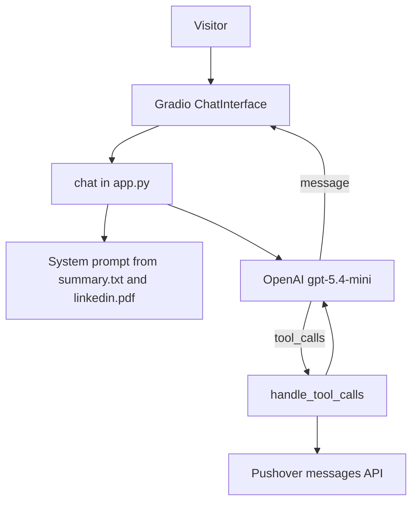

# Career Agent

A Gradio chat that answers questions about Rishabh Sharma's career. It uses a short biography and a LinkedIn PDF as context, and it can notify you on Pushover when someone leaves an email or asks something it cannot answer.

## Project Overview

`app.py` builds a Gradio `ChatInterface` titled "Digital Twin". Each turn sends the system prompt, the chat history, and the new user message to the OpenAI chat completions API (`gpt-5.4-mini`) with two tools. If the model calls a tool, `tools.py` runs it and the chat request is sent again until the model returns a normal message.

The system prompt is built in `context.py` at import time from `summary.txt` and the text extracted from `linkedin.pdf`. The prompt tells the model to stay on career, background, skills, and experience, to say it is an AI twin, and not to invent facts.

The YAML block at the top of this file is the Hugging Face Space config (`sdk: gradio`, `app_file: app.py`). Leave it in place if this repo is deployed as a Space.

## Features

- Career chat with example prompts (background, current projects, skills, getting in touch)
- Answers grounded in `summary.txt` and `linkedin.pdf`
- `record_user_details` when a visitor shares an email
- `record_unknown_question` when the model does not know an answer
- Pushover notification for both tools
- Custom light and dark styling in `styles.py`

## Tech Stack

- Python
- Gradio 6 (Space config pins `sdk_version: 6.14.0`)
- OpenAI Python SDK (`OpenAI()` chat completions)
- `pypdf` to read `linkedin.pdf`
- `python-dotenv` to load a local `.env`
- `requests` for Pushover

Dependencies are listed in `requirements.txt` without pinned versions: `requests`, `gradio`, `pypdf`, `openai`, `python-dotenv`.

## Architecture



### One turn

1. `chat` builds `messages` as the system prompt, prior history, and the latest user message.
2. It calls `chat.completions.create` with `tools`.
3. While `finish_reason` is `tool_calls`, it runs `handle_tool_calls`, appends the assistant tool call and the tool results, and calls the model again.
4. The final message content is what Gradio shows.

`record_user_details` sends a Pushover message with the visitor's email, name, and notes. `record_unknown_question` sends the question that could not be answered. Both return `"OK"` to the model.

## Local Setup

```bash
python3 -m venv .venv
source .venv/bin/activate
pip install -r requirements.txt
python app.py
```

`linkedin.pdf` and `summary.txt` must sit next to `context.py`. Importing `context.py` reads both files immediately.

`.gitignore` is `*env`, so a file named `.env` is ignored.

### Environment variables

| Variable | Required | Purpose |
| --- | --- | --- |
| `OPENAI_API_KEY` | Yes | Read by the OpenAI SDK. `load_dotenv()` runs in `app.py` and `tools.py`. |
| `PUSHOVER_USER` | For notifications | Pushover user key. |
| `PUSHOVER_TOKEN` | For notifications | Pushover application token. |

```bash
OPENAI_API_KEY=sk-...
PUSHOVER_USER=...
PUSHOVER_TOKEN=...
```

`tools.push` posts to `https://api.pushover.net/1/messages.json` whenever a tool runs. It does not check that the Pushover variables are set first. Without them, the tool still returns `"OK"` to the model after the HTTP call.

## Database Design

No database. Chat history is the Gradio session. Contact emails and unknown questions are sent to Pushover and are not written to a table.

## API Overview

This app does not serve a public HTTP API of its own beyond whatever Gradio binds for the UI.

Outbound calls:

| Target | When |
| --- | --- |
| OpenAI chat completions | Every turn, and again after each tool round |
| `https://api.pushover.net/1/messages.json` | `record_user_details` or `record_unknown_question` |

## Security

- Keep `OPENAI_API_KEY`, `PUSHOVER_USER`, and `PUSHOVER_TOKEN` in `.env` or the host environment. `.gitignore` ignores names ending in `env`.
- The system prompt includes the biography and the extracted LinkedIn text. Anything in those files can be repeated to visitors.
- Tool handlers trust the model's arguments (`email`, `name`, `notes`, `question`) and forward them to Pushover.
- Unknown tools return an error string to the model instead of raising.

## Design Decisions

- One system prompt assembled at startup, so the PDF is parsed once per process rather than once per message.
- Tool calls are a `while` loop on `finish_reason == "tool_calls"`, which allows the model to record a question and then answer in the same turn.
- The model is instructed to use `record_unknown_question` instead of guessing, and `record_user_details` only after the visitor gives an email.
- Styling is a Gradio CSS and JS override in `styles.py` (gold, blue, and purple accents, square corners, example prompts). The chat launches with `gr.themes.Base()`.

## Optimizations

- LinkedIn text and `summary.txt` are read once at import and interpolated into `TWIN_SYSTEM_PROMPT`.
- The tool list is two functions. The model is not given a general web search or a mailer.
- Example prompts are static strings, so the first screen does not wait on the model.

## Deployment

Local:

```bash
python app.py
```

Hugging Face Spaces: this README's front matter sets `sdk: gradio`, `app_file: app.py`, and `sdk_version: 6.14.0`. The Space needs `OPENAI_API_KEY`, `PUSHOVER_USER`, and `PUSHOVER_TOKEN` as secrets, and it needs `linkedin.pdf` and `summary.txt` in the repo. Do not remove the YAML block.

There is no Dockerfile.

## Lessons Learned

- `context.py` fails on import if `linkedin.pdf` or `summary.txt` is missing. Both files are part of startup, not optional attachments.
- Pushover is the only record of leads and unanswered questions. If those notifications matter, the Pushover keys have to be set in every environment, including the Space.
- The model is told not to invent answers and to record gaps. The quality of answers still depends on `summary.txt` and the PDF text `pypdf` extracts.
- Replacing this README without the Hugging Face front matter would drop the Space SDK config. Keep the `---` block at the top.

## License

This repository has no `LICENSE` file.
